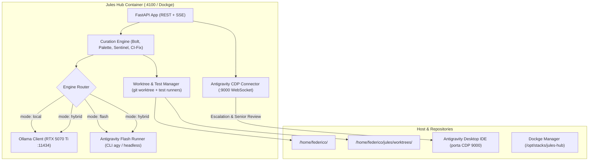

# Specifica Architetturale: Jules Hub (Autonomous Junior Coder & Antigravity Escalation Pipeline)

- **Data**: 2026-10-31
- **Repository**: `cavuminfundo/jules-hub` (`/home/federico/jules`)
- **Stato**: Proposed / Convalidato da Grill-Me
- **Autori**: Antigravity & federico

---

## 1. Visione di Prodotto & Modello Organizzativo (Junior/Senior Coder)

Jules Hub è la re-implementazione autonoma e self-hosted di **Google Jules**, progettata per eliminare l'attrito umano nella manutenzione proattiva del software.

### Il Pattern Organizzativo "Junior / Senior Developer"
Il flusso ricalca esattamente la dinamica di un team di sviluppo reale:

1. **Jules (Junior Coder)**:
   - Lavora costantemente in background a basso costo di token (modello **Flash** di Antigravity, **Ollama** locale sulla GPU RTX 5070 Ti, o modalità **Ibrida**).
   - Scansiona proattivamente i repository (hotspot, failure di CI, regressioni nei test, bottleneck di performance Bolt, gap di accessibilità Palette, falle di sicurezza Sentinel).
   - Crea un **git worktree isolato al 100%** (`worktrees/<repo>-<persona>-<timestamp>`), preservando intatto il working tree principale dello sviluppatore.
   - Applica la micro-patch (`< 50` righe).
   - Esegue la suite di test del progetto (`pytest`, `./run_fast_tests.sh`, `npm test`).
   - Se i test falliscono, tenta fino a **2 retry**. Se ancora fallisce, congela lo stato e alza il flag di escalation.
2. **Antigravity (Senior Coder / Reviewer)**:
   - Riceve l'escalation automatica da Jules tramite il bridge locale (porta CDP `9000` o API/CLI).
   - Esegue la **Dual-Gate Code Review** (Audit di qualità, verifica di sicurezza Sentinel, controllo assenza regressioni).
   - Se necessario, interviene con capacità di reasoning avanzate (**Gemini Pro**) per correggere edge-case complessi.
   - Una volta validata e confermata la patch, apre la **Pull Request su GitHub** (o effettua il merge diretto se abilitato) e notifica lo sviluppatore con un report completo.
3. **Lo Sviluppatore (Tech Lead)**:
   - Non perde più tempo a copiare link di PR tra tool diversi o a istruire manualmente Antigravity su cosa revisionare.
   - Ha a disposizione la **Web Dashboard di Jules Hub** (gestita via Dockge su porta `4100`) per monitorare lo stato di tutti i repository, le schede delle suggestioni, i worktree attivi e i verdetti di revisione.

---

## 2. Modalità di Calcolo & Quota Shield (3 Engine Mode)

Per proteggere la quota cloud e consentire la massima flessibilità, Jules supporta 3 modalità operative selezionabili globalmente o per singolo repository:

| Modalità | Motore di Scansione & Patch | Costo Token Cloud | Target / Use-Case Ideale |
|---|---|---|---|
| **`antigravity_flash`** (Default) | Antigravity CLI / Subagent con modello **Flash** | Bassissimo (quota estesa) | Manutenzione ordinaria, analisi semantica rapida, fix veloci. |
| **`local`** | Ollama locale su GPU RTX 5070 Ti (Qwen2.5-Coder) | **0 Token Cloud** | Progetti non critici, funzionamento offline, analisi batch estese. |
| **`hybrid`** | Ollama per scansione iniziale $\to$ Antigravity Flash per edit/test | Minimo (solo per patch) | Pipeline di monitoraggio continuo ad alta efficienza. |

In tutte le modalità, l'escalation di revisione al Senior Coder (Antigravity Desktop / Pro) avviene solo su lavoro già preparato e testato dal Junior.

---

## 3. Architettura Tecnica del Backend (`jules-hub`)

Il backend è un'applicazione Python FastAPI/Uvicorn containerizzata:



### Componenti Chiave del Backend:
1. **WorktreeManager**:
   - Gestisce la creazione atomica di git worktree: `git worktree add -b curator/<mode>-<id> /home/federico/jules/worktrees/<name> HEAD`.
   - Riconosce ed esegue i runner di test dei progetti target (`detect_test_command`, `./run_fast_tests.sh`, `pytest`, `npm test`).
   - Gestisce il rollback sicuro e il pruning dei worktree orfani (`curator cleanup`).
2. **Curation Engine (Junior Coder)**:
   - **Trigger CI Auto-Fix**: legge le PR con check falliti tramite GitHub CLI / API e isola il traceback.
   - **Trigger Proattivo (Bolt/Palette/Sentinel)**: ispeziona i file recenti o gli hotspot di CodeGraph con la lente della Persona scelta.
   - **Execution Loop**:
     - Baseline check: verifica che i test attuali passino (salvo in CI-Fix dove riproduce il fallimento).
     - Generazione modifica (`< 50` righe).
     - Verifica test: se RED, fino a 2 cicli di auto-correzione. Se GREEN, finalizza il commit locale nel worktree.
3. **Escalation Connector (CDP Bridge :9000)**:
   - Connessione WebSocket a `ws://127.0.0.1:9000/devtools/page/...`.
   - Invia la richiesta di Senior Review ad Antigravity Desktop:
     ```json
     {
       "action": "senior_review",
       "repo": "RoosterLab",
       "worktree_path": "/home/federico/jules/worktrees/roosterlab-bolt-1",
       "branch": "curator/bolt-20261031-1530",
       "diff_summary": "Cache decorator su store_service.py",
       "test_status": "PASSED (14 fast tests green)",
       "instruction": "Esegui audit Senior. Se approvato, apri la PR su GitHub."
     }
     ```

---

## 4. Interfaccia Web Dashboard (UI/UX)

La dashboard web, servita da FastAPI su porta `4100`, è il cockpit del Tech Lead:
- **Repository Grid**: Stato dei 14 progetti registrati in `projects_registry.json` (ramo attivo, stato worktree, health dei test).
- **Junior Coder Feed (Bacheca Suggestioni & Fix)**:
  - Badge Persona: ⚡ **Bolt** (Performance), 🎨 **Palette** (UX/a11y), 🛡️ **Sentinel** (Sicurezza), 🧪 **Tests**, 🛠️ **CI-Fix**.
  - Badge Stato: `Testing`, `Passed (Ready for Senior Review)`, `Retry (1/2)`, `Needs Escalation (Tests Failing)`.
- **Card Azioni**:
  - `[ 🎓 Invia a Senior Review (Antigravity) ]`: apre la chat in Antigravity per la revisione formale e l'apertura PR.
  - `[ 🔍 Visualizza Diff & Test Log ]`: drawer interattivo con diff a colori e output della console.
  - `[ 🧹 Prune / Scarta Worktree ]`: eliminazione pulita del branch e della directory worktree.

---

## 5. Strategia di Packaging e Deploy (Dockge & GHCR)

1. **Repository GitHub**: `cavuminfundo/jules-hub`.
2. **CI/CD Workflow (`.github/workflows/docker-publish.yml`)**:
   - Multi-stage build (Node per compilazione frontend SPA + Python 3.12 slim runtime).
   - Pubblica automaticamente su `ghcr.io/cavuminfundo/jules-hub:latest`.
3. **Deploy in Dockge**:
   - Stack `/opt/stacks/jules-hub/compose.yaml`:
     ```yaml
     services:
       jules-hub:
         image: ghcr.io/cavuminfundo/jules-hub:latest
         container_name: jules_hub
         restart: unless-stopped
         network_mode: host
         user: "1000:1000"
         volumes:
           - /home/federico:/home/federico:rw
           - /var/run/docker.sock:/var/run/docker.sock
         environment:
           - PORT=4100
           - CD_DEBUG_PORT=9000
           - OLLAMA_HOST=http://localhost:11434
     ```

---

## 6. Piano di Implementazione & Passi Successivi

1. **Fase 1 (Backend Core & Jr Runner)**:
   - Refactor di `curator.py` in modulo `src/` o `hub/` con `WorktreeManager`, `EngineRouter` (Flash / Local / Hybrid), e `EscalationBridge`.
2. **Fase 2 (FastAPI & CDP Integration)**:
   - Endpoint REST (`/api/projects`, `/api/tasks`, `/api/escalate`, `/api/worktrees`).
   - WebSocket client per iniezione diretta su Antigravity Desktop (porta 9000).
3. **Fase 3 (Web UI)**:
   - Dashboard React/Tailwind con feed delle attività Junior/Senior, diff viewer e log streaming.
4. **Fase 4 (Dockge Stack & GHCR)**:
   - Dockerfile multi-stage, push su GitHub `main` e avvio stack in Dockge.
